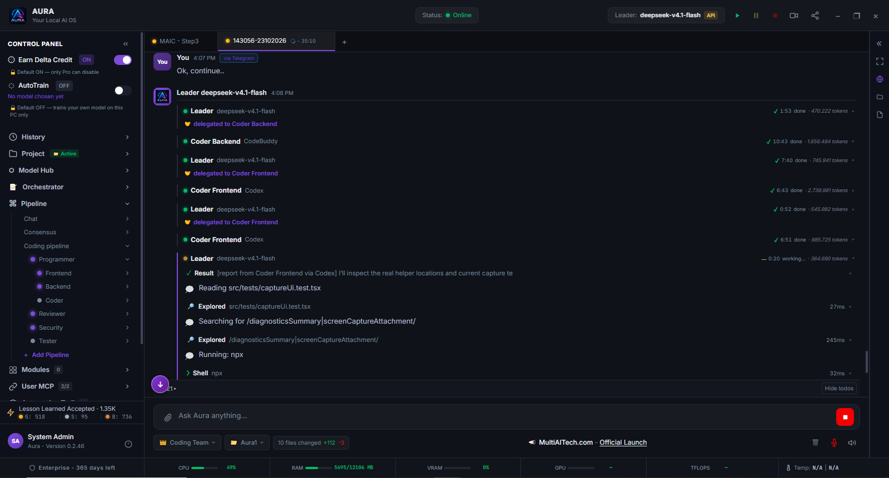

*The Aura desktop app executing a multi-model pipeline on a real documentation task in this repository. The Leader delegates to Coder Backend, then to Coder Frontend, then takes a verification pass of its own; the right-hand column shows the actual per-role token usage and duration, and each role is executed by a different model. Aura runs on your own machine with your own API keys, so the models may be remote (premium or free) or local depending on your configuration. The Programmer, Reviewer, Security and Tester roles can be switched on or off per run from the Control Panel, which is why two of them are inactive in this session. The first message in the transcript was sent from Telegram.*

# AURA - Desktop AI OS

**AURA** (Autonomous Unified Reasoning Agent) is a Windows desktop application that runs a team of AI agents on your own machine. You install it, point it at your own provider keys, and it plans, writes, reviews and verifies work - with a human in the loop wherever the work can touch your computer.

Status: **desktop beta**. A build is published for download in the member portal. AURA is not yet generally available and has no public app-store listing.

## What "local" means

*Your Local AI OS* means the **application** runs locally. Your projects, conversation history, credentials and the agent processes stay on your machine, and with your own keys Aura calls the model provider directly - there is no Aura relay in the middle of your model traffic.

It does not mean the models run locally. Aura can call remote providers, run a local model, or mix both in the same run.

One thing is deliberately not local: completed tasks are counted against your member plan through the MAIC usage gate (a free tier exists). That gate fails **open** - if the server cannot be reached, your work is never blocked.

## 1. Multi-agent orchestration

- **Role-based agents** - Leader, Coder Frontend, Coder Backend, Reviewer, Security, Tester. Each role has its own job, turn and trail, so the Leader can delegate and verify instead of one model doing everything.
- **Per-role model binding** - every role can run on a different model or a different executor: a cloud API, an external coding harness, or a local model. A cheaper model for mechanical work, a stronger one for review.
- **Consensus instead of a single guess** - a coder writes, a reviewer checks, and when the review is wrong the Leader re-asks and keeps the evidence. Turns, delegations, reviews and verifications stay visible in the transcript.
- **Failover** - when a role's executor dies (API down, quota exhausted, harness crash) the Leader replaces it with an equal-capability executor and says so in the transcript. It does not silently swap your chosen model for a different one.
- **Watchdog and loop guard** - a role stuck repeating the same command is detected and taken over before it burns your tokens.

## 2. Zero-config

- **Talk to the Leader** - installing a harness, connecting an MCP server or adding a skill is a sentence in the chat, not a config file.
- **Skill builder** - add a capability through a plain-language form, a JSON definition, or a URL; the Leader reads the source and installs it.
- **Project-based history** - sessions are grouped by project, and an auto-named session can be renamed.

## 3. Privacy and safety

- **PII masking** - before a Lesson Learned is stored or sent to the community server, folder paths, API keys, e-mail addresses, phone numbers and long ID numbers are replaced with mask tokens. The unmasked text stays on your machine.
- **Approval gate for risky work** - a shell command, an interpreter line, a file write or a browser action that needs permission stops the run and asks you. The dialog shows the **raw command** that would run, so you approve the thing itself rather than a summary of it.
- **Allow once, or allow in session** - work that can damage your machine is never granted permanently.
- **PIN lock** - the app can be locked with a 6-digit PIN, stored only as a PBKDF2-HMAC-SHA256 hash in the OS credential vault, with a lockout after repeated wrong entries. The PIN is set from the member area.
- **Egress policy and TLS pinning** - hosts can be allowed or denied, and connections are pinned.

## 4. Remote control and streaming

- **Telegram** - follow the run, send a command, and approve or reject a pending action from your phone.
- **Voice** - spoken commands, and every message is marked *Via Voice* or *Via Telegram* so you can see where it came from.
- **Built-in live streaming** - Aura ships its own encoder: H.264/AAC to RTMP or RTMPS, no OBS needed. Capture the whole desktop or **a single window** (Aura only), add your microphone, and the stream key is kept in the OS credential vault, masked in the UI and scrubbed from the logs. A draggable, scroll-resizable camera bubble is composited into the recording.
  - Honest limit: you paste your own YouTube or TikTok RTMP server URL and stream key. There is no OAuth "connect your channel" flow.
- **Aura News banner** - an in-app banner for announcements and live-stream notices.

## 5. Lesson Learned economy

- **LL capture and grading** - Aura records how a problem was actually solved on your machine and grades it: **Bronze** (still failing), **Silver** (works but needs revision), **Gold** (solved a real problem in your environment). Gold requires evidence, not claims.
- **Anti-fraud by construction** - you pay for the tokens, so a fabricated record costs you real money.
- **Server-side re-check** - records are re-checked server-side (PII redaction, similarity) before they are accepted.
- **Marketplace** - owned and licensed LL are listed in the member portal and settled in MAIC; licensed bundles are delivered encrypted and unlocked per session.
  - Honest status: MAIC has no DEX pair yet, so treat on-chain settlement as not open.
- **AutoTrain** - fine-tune a local model on your own LL. It runs under a hard brake: training pauses before RAM reaches 90% of **total** system memory, 15% (minimum 1 GiB) of VRAM is kept free, and it can be scheduled to run only in chosen hours.

## 6. Developer workflows

- **Build, hash, upload** - when you ask it to, Aura runs the build, computes the SHA-256 and uploads the artifact itself. See [Verify a build](docs/verify-a-build.md) for the check a user can repeat.
- **Status where you are** - build status, errors and the system log are surfaced in the app and can be pushed to Telegram.
- **Updates and licensing** - Google sign-in ties the app to your member account, and the in-app Update button installs a new version when one is published.

## Also in the box

A built-in browser the agent can drive, MCP servers, per-project context, layered memory, Modules with schedules, and a local API.

## Where the limits are

This page describes the app as built, and each limit is written next to the feature it limits. In short: AURA is a beta, live streaming needs your own RTMP credentials, and the MAIC marketplace is not open because the token is not tradeable yet.

Documentation set: [README](README.md) - [Verify a build](docs/verify-a-build.md).
